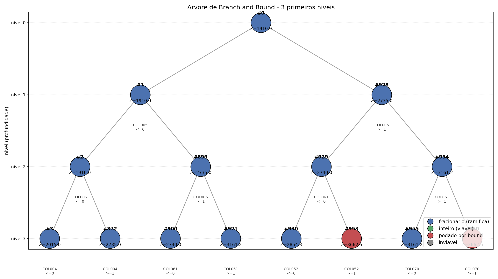
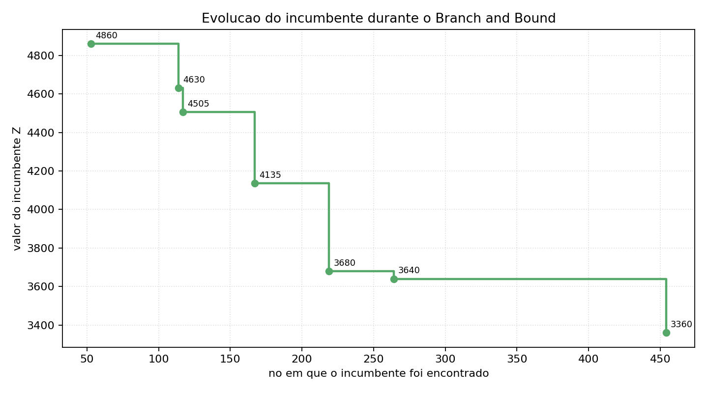

# Resolução de Problemas Lineares Inteiros via Simplex e Branch and Bound

**Instância de benchmark:** `misc03` — MIPLIB 2017 (Benchmark Set)

**Integrantes:** Pedro Henrique Vilaça Valverde, Gabriel Batista

**Disciplina:** Otimização de Sistemas — PUC Minas

**Data:** 25 de setembro de 2026

---

## Sumário

1. [Síntese do problema](#1-síntese-do-problema)
2. [Resultados fornecidos por diferentes IAs](#2-resultados-fornecidos-por-diferentes-ias)
3. [Leitura da instância de benchmark](#3-leitura-da-instância-de-benchmark)
4. [Modelagem matemática](#4-modelagem-matemática)
5. [Relaxação linear (Simplex)](#5-relaxação-linear-simplex)
6. [Algoritmo Branch and Bound](#6-algoritmo-branch-and-bound)
7. [Análise crítica: integrality gap e poda](#7-análise-crítica-integrality-gap-e-poda)
8. [Discussão e comparação com as soluções das IAs](#8-discussão-e-comparação-com-as-soluções-das-ias)
9. [Referências](#9-referências)

---

## 1. Síntese do problema

A instância `misc03` integra o *Benchmark Set* do MIPLIB 2017 e foi submetida por
Greg Astfalk (Convex Computer Corporation); sua aplicação industrial original não é
divulgada publicamente, sendo classificada como aplicação desconhecida. Trata-se de um
**problema puro de programação inteira 0-1** com 160 variáveis de decisão — 159 binárias
e 1 contínua livre — distribuídas em 96 restrições lineares (27 igualdades, 38 "≤" e 31
"≥") e 2.053 coeficientes não-nulos. A função objetivo, de minimização, é o valor de uma
única variável de folga contínua (`COL160`) que fecha uma igualdade de balanço de custos,
enquanto as variáveis binárias selecionam combinações de itens e respeitam cotas de
capacidade e exigências de cobertura. A relaxação linear fornece **Z = 1910,0** e a
solução inteira ótima é **Z = 3360,0**, o que evidencia um *integrality gap* de
aproximadamente **43%** e motiva o emprego de Branch and Bound.

---

## 2. Resultados fornecidos por diferentes IAs

### 2.1 Desenho do experimento

Foram avaliadas **três IAs** em **dois modos de uso**, totalizando seis respostas para a
mesma instância:

| IA (modelo e versão) | Modo não-agêntico | Modo agêntico |
|---|---|---|
| GLM 5.3 (`glm-5.3`) | apenas texto | cria e executa código |
| DeepSeek V4.1 Flash (`deepseek-v4.1-flash`) | apenas texto | cria e executa código |
| Kimi K2.7 Code (`kimi-k2.7-code`) | apenas texto | cria e executa código |

Os valores de referência da equipe são $Z_{LP} = 1910{,}00$, $Z_{IP} = 3360{,}00$ e gap de
43,15%.

- **Modo não-agêntico:** o modelo recebe os dados da instância embutidos no prompt e
  responde **apenas com texto**, sem acesso a ferramentas, arquivos ou internet.
- **Modo agêntico:** o modelo recebe os arquivos CSV e pode **escrever e executar código
  Python** (PuLP + CBC) para resolver a instância, em um container Docker isolado.

### 2.2 Modo não-agêntico

Prompt com os dados completos embutidos (transcrições em `report/ai_answers/nao_agentico/`):

```
MIPLIB misc03. Colunas 1-159 binarias (obj 0), col 160 continua livre (obj 1).
Cada linha: ROWxxx tipo rhs | coefs coluna (vazio=+1, '-'=-1).
... (as 96 restricoes com todos os 2053 coeficientes) ...

Responda CONCISO (max 15 linhas): 1) sintese 2) Z_LP 3) Z_IP 4) gap% 5) poda B&B.
Termine com Z_LP= / Z_IP= / GAP_PCT=. NAO escreva raciocinio.
```

| IA | Z relaxado | Z inteiro | Gap (%) | Resultado |
|---|---|---|---|---|
| GLM 5.3 | 3360,00 | 3360,00 | 0,00 | ✘ Assumiu que a relaxação LP já é inteira; gap nulo. |
| DeepSeek V4.1 Flash | 3360,00 | 3360,00 | 0,00 | ✘ Também afirmou que o politopo é integral no ótimo. |
| Kimi K2.7 Code | 1916,30 | 3360,00 | 42,97 | ≈ O único a reconhecer gap não nulo; aproximou $Z_{LP}$. |
| **Equipe (referência)** | **1910,00** | **3360,00** | **43,15** | Calculado com CBC/HiGHS (Seções 5–7). |

**GLM 5.3 e DeepSeek V4.1 Flash erraram o ponto central do trabalho.** Reportaram
$Z_{LP} = 3360$, isto é, o *próprio ótimo inteiro*, e concluíram que o *integrality gap* é
zero. Ambos afirmaram explicitamente que o politopo da relaxação é integral no ótimo, sem
resolver o LP. As respostas são qualitativamente sofisticadas (descrevem corretamente a
estrutura de partições e coberturas), mas falham no valor numérico.

**Kimi K2.7 Code** foi o único a perceber que a relaxação linear é estritamente melhor que
o ótimo inteiro: reportou $Z_{LP} \approx 1916{,}3$ (real: 1910,00) e gap de 42,97% (real:
43,15%), com erro relativo de ~0,3% no $Z_{LP}$. Nenhum dos três, porém, executou de fato
Simplex ou Branch and Bound.

### 2.3 Modo agêntico

Neste modo, cada modelo recebeu os três CSVs e um ambiente com **Python 3.11 + PuLP + CBC**
(sem internet), podendo escrever e executar código livremente. O prompt (transcrições em
`report/ai_answers/agentico/`):

```
... tres CSVs com a instancia MIPLIB misc03 (variables, constraints, coefficients) ...
O ambiente tem Python 3.11 com PuLP e CBC instalados. NAO acesse a internet.
Resolva a instancia escrevendo e executando codigo Python.
Ao final: 1) sintese 2) formulacao 3) Z_LP 4) Z_IP 5) gap e poda B&B.
Termine com Z_LP= / Z_IP= / GAP_PCT=.
```

| IA | Chamadas de ferramenta | Z relaxado | Z inteiro | Gap (%) | Resultado |
|---|---|---|---|---|---|
| GLM 5.3 | 76 | 1910,00 | 3360,00 | 43,15 | ✔ Correto |
| DeepSeek V4.1 Flash | 48 | 1910,00 | 3360,00 | 43,15 | ✔ Correto |
| Kimi K2.7 Code | 99 | 1910,00 | 3360,00 | 43,15 | ✔ Correto |
| **Equipe (referência)** | — | **1910,00** | **3360,00** | **43,15** | Calculado com CBC/HiGHS (Seções 5–7). |

**Os três modelos acertaram.** Todos montaram o modelo no PuLP a partir dos CSVs,
resolveram a relaxação (1910) e o problema inteiro (3360) com o CBC, e reportaram gap de
43,15%. Os três descreveram corretamente a poda do B&B e citaram métricas internas do
solver — por exemplo, 350 nós e 22.739 iterações simplex no problema inteiro, e cortes na
raiz que elevam o *bound* de 1910 para 2555,55. São valores consistentes com os obtidos
pela equipe (Seção 7), o que evidencia que o código foi realmente executado.

### 2.4 Comparação dos dois modos

| IA | $Z_{LP}$ (não-agêntico) | $Z_{LP}$ (agêntico) | $Z_{IP}$ (não-agêntico) | $Z_{IP}$ (agêntico) |
|---|---|---|---|---|
| GLM 5.3 | 3360,00 ✘ | 1910,00 ✔ | 3360,00 | 3360,00 |
| DeepSeek V4.1 Flash | 3360,00 ✘ | 1910,00 ✔ | 3360,00 | 3360,00 |
| Kimi K2.7 Code | 1916,30 ≈ | 1910,00 ✔ | 3360,00 | 3360,00 |

O resultado é categórico: **no modo não-agêntico, 2 de 3 modelos erraram o $Z_{LP}$**;
**no modo agêntico, os 3 acertaram**. O mesmo modelo (DeepSeek V4.1 Flash) responde 3360
sem código e 1910 com código. Isso mostra que a limitação **não é de conhecimento** — os
modelos "sabem" o que é relaxação e B&B — mas de **cálculo**: sem um solver, eles
aproximam a resposta por inferência estrutural ("a matriz parece integral") e erram.

### 2.5 Como as IAs foram utilizadas

As IAs foram usadas **exclusivamente** para o tópico 2. Foram aproveitadas apenas ideias
qualitativas (estrutura de partição/cobertura, papel de `COL160` como variável de folga);
**nenhum valor numérico** das respostas foi incorporado ao relatório. Todos os números das
Seções 3–7 foram calculados pela equipe com CBC e HiGHS.

- **Interface e modelos:** Ollama Cloud (plano Pro), modelos abertos, em 25/09/2026
  (não-agêntico) e 16/10/2026 (agêntico).
- **Modo não-agêntico:** agente sem ferramentas (sem bash, leitura de arquivos ou
  internet), garantindo que o resultado viesse apenas do raciocínio do modelo.
- **Modo agêntico:** o modelo podia escrever e executar código Python, mas **em um
  container Docker isolado** com apenas os CSVs montados e **sem acesso à internet** — o
  que impede consultar a resposta publicada da instância e força a resolução real.
- **Observação técnica:** o GLM 5.3 apresentou instabilidade no modo não-agêntico ao
  receber o *dump* completo (loops de raciocínio); a resposta registrada foi obtida após
  repetições. No modo agêntico não houve esse problema, pois o modelo delegou o cálculo ao
  código.
- **Registro:** transcrições integrais em `report/ai_answers/nao_agentico/*.txt` e
  `report/ai_answers/agentico/*.txt`, com resumos em `resumo_ias.json`. Um lote preliminar
  com modelos gratuitos está em `report/ai_answers/preliminar/`.

---

## 3. Leitura da instância de benchmark

A instância foi obtida no formato MPS (cópia oficial disponível no repositório do solver
SCIP) e processada por um *parser* MPS próprio. Para atender ao requisito de leitura via
CSV, a instância foi exportada em três arquivos de representação esparsa:

| Arquivo | Colunas | Linhas |
|---|---|---|
| `misc03_variables.csv` | `column, lower, upper, is_integer, obj_coeff` | 160 |
| `misc03_constraints.csv` | `constraint, type, rhs` | 96 |
| `misc03_coefficients.csv` | `constraint, column, value` | 2.053 |

Estatísticas da instância:

| Métrica | Valor |
|---|---|
| Variáveis de decisão | 160 (159 binárias + 1 contínua livre) |
| Restrições | 96 (27 `=`, 38 `≤`, 31 `≥`) |
| Coeficientes não-nulos | 2.053 |
| Sentido da otimização | Minimização |
| Melhor solução conhecida (MIPLIB) | 3360 (ótimo) |
| Solução da relaxação (MIPLIB) | 1910,0 |

---

## 4. Modelagem matemática

Sejam $x_j$ as variáveis de decisão, com $x_j \in \{0,1\}$ para as 159 variáveis binárias
e $x_{160} \in \mathbb{R}$ livre.

**Função objetivo (minimização):**

$$
\min \; Z = \sum_{j=1}^{160} c_j \, x_j = x_{160}
$$

O único coeficiente objetivo não-nulo é $c_{160} = 1$; a variável $x_{160}$ funciona como
variável de folga que fecha a igualdade de balanço `ROW001`.

**Conjunto de restrições.** Para cada linha $i$ do arquivo MPS:

$$
\sum_{j=1}^{160} a_{ij}\, x_j \;\{\le,\ \ge,\ =\}\; b_i,
\qquad i = 1, \dots, 96
$$

com os tipos e lados direitos $b_i$ definidos no arquivo `misc03_constraints.csv`. As
restrições de integralidade

$$
x_j \in \{0,1\}, \qquad j \in \mathcal{I},\quad |\mathcal{I}| = 159
$$

completam o modelo. As restrições de capacidade (linhas do tipo `L`) usam coeficientes
como 100 e 200; as de cobertura (tipo `G`) têm coeficientes unitários; e as igualdades
(`E`) impõem exatamente um item por grupo, além do balanço de custos da linha `ROW001`.

---

## 5. Relaxação linear (Simplex)

Resolvendo o mesmo modelo **sem** as restrições de integralidade (todas as variáveis
tornam-se contínuas), obtém-se:

| Métrica | Valor |
|---|---|
| Status | Ótimo |
| **Z relaxado** | **1910,00** |
| Tempo de processamento | ≈ 0,008 s (8 ms) |
| Variáveis fracionárias | 12 de 159 binárias |

Todas as 12 variáveis fracionárias assumem exatamente o valor **0,5**:
`COL006, COL011, COL024, COL028, COL046, COL063, COL065, COL076, COL094, COL101, COL119,
COL135`. Esse padrão é típico de problemas com estrutura de "escolha exatamente um por
grupo": a relaxação linear divide a escolha pela metade entre dois candidatos, reduzindo
artificialmente o custo. O solver empregado foi o CBC (método Simplex/dual) via PuLP.

---

## 6. Algoritmo Branch and Bound

### 6.1 Solução inteira via CBC

A resolução do PLI completo pelo Branch and Bound nativo do CBC fornece:

| Métrica | Valor |
|---|---|
| Status | Ótimo |
| **Z inteiro ótimo** | **3360,00** |
| Tempo de processamento | ≈ 1,9 s |

### 6.2 Branch and Bound implementado pela equipe

Implementamos o algoritmo do zero, com as seguintes decisões de projeto:

- **Relaxação linear em cada nó:** solver Simplex HiGHS (`scipy.optimize.linprog`);
- **Estratégia de busca:** profundidade primeiro (DFS);
- **Ramificação:** na variável mais fracionária $x_j$, gerando os ramos
  $x_j \le \lfloor x_j^* \rfloor$ e $x_j \ge \lceil x_j^* \rceil$;
- **Poda:** por limitante ($Z_{LP}^{\text{nó}} \ge Z_{\text{incumbente}}$), por
  integralidade e por inviabilidade.

Resultados:

| Métrica | Valor |
|---|---|
| **Z inteiro ótimo** | **3360,00** |
| Prova de otimalidade | Sim |
| Nós explorados | 961 |
| LPs resolvidos | 961 |
| Tempo total | ≈ 1,4 s |
| Profundidade máxima | 47 |
| Variáveis não-nulas na solução | 16 (15 binárias + `COL160` = 3360) |

Solução ótima inteira (variáveis binárias iguais a 1):
`COL020, COL023, COL063, COL079, COL094, COL118, COL131, COL135, COL148, COL149, COL151,
COL153, COL155, COL156, COL158` — e `COL160 = 3360`.

### 6.3 Árvore de busca (3 primeiros níveis)

A Figura 1 mostra os três primeiros níveis de ramificação. Cada nó exibe o limitante
obtido pela relaxação linear e cada aresta indica a variável e o sentido da ramificação.



A Tabela abaixo detalha os limites por nó:

| Nível | Nó | Limitante Z | Status | Ramificação |
|---|---|---|---|---|
| 0 (raiz) | #0 | 1910,00 | fracionário | — |
| 1 | #1 | 1910,00 | fracionário | `COL005 ≤ 0` |
| 1 | #928 | 2735,00 | fracionário | `COL005 ≥ 1` |
| 2 | #2 | 1910,00 | fracionário | `COL006 ≤ 0` |
| 2 | #899 | 2735,00 | fracionário | `COL006 ≥ 1` |
| 2 | #929 | 2740,00 | fracionário | `COL061 ≤ 0` |
| 2 | #954 | 3161,25 | fracionário | `COL061 ≥ 1` |
| 3 | #3 | 2015,00 | fracionário | `COL004 ≤ 0` |
| 3 | #872 | 2735,00 | fracionário | `COL004 ≥ 1` |
| 3 | #900 | 2740,00 | fracionário | `COL061 ≤ 0` |
| 3 | #921 | 3161,25 | fracionário | `COL061 ≥ 1` |
| 3 | #930 | 2854,29 | fracionário | `COL052 ≤ 0` |
| 3 | #953 | 3662,50 | **podado por bound** | `COL052 ≥ 1` |
| 3 | #955 | 3161,25 | fracionário | `COL070 ≤ 0` |
| 3 | #960 | 3662,50 | **podado por bound** | `COL070 ≥ 1` |

Observa-se que os nós #953 e #960 já apresentam limitante 3662,50 > 3360 (ótimo), sendo
podados antes de qualquer ramificação adicional.

### 6.4 Evolução do incumbente

O primeiro incumbente viável (Z = 4860) foi encontrado no nó #53; o ótimo Z = 3360 surgiu
no nó #454, permanecendo até a prova final. A sequência de incumbentes foi:

$$
4860 \to 4630 \to 4505 \to 4135 \to 3680 \to 3640 \to \mathbf{3360}
$$

A Figura 2 ilustra essa evolução.



---

## 7. Análise crítica: integrality gap e poda

### 7.1 Integrality gap

O *integrality gap* quantifica a perda de qualidade ao impor a integralidade:

$$
\text{gap} = \frac{Z_{IP} - Z_{LP}}{|Z_{IP}|} \times 100\%
= \frac{3360 - 1910}{3360} \times 100\% \approx 43{,}15\%
$$

Com gap absoluto de **1450** unidades, o resultado indica que a relaxação linear fornece um
limitante inferior bastante frouxo — o custo real é cerca de 1,76× o custo relaxado. Esse
valor elevado é explicado pela estrutura de "escolha exatamente um por grupo": a relaxação
linear "frauda" a decisão dividindo cada escolha binária em 0,5, o que reduz o custo de
forma irreal. Por isso, o Branch and Bound precisa explorar um número relevante de nós
(961) antes de provar a otimalidade, ainda que o problema seja de pequeno porte.

### 7.2 Como o algoritmo podou os ramos

Em um problema de minimização, cada nó fornece um **limitante inferior** via relaxação
linear. O nó é descartado quando:

1. **Poda por limitante:** $Z_{LP}^{\text{nó}} \ge Z_{\text{incumbente}}$ — nenhum ponto
   inteiro do ramo pode melhorar o melhor incumbente conhecido. Foi o critério mais
   importante, responsável por **345 nós (35,9%)**.
2. **Poda por inviabilidade:** a relaxação linear é infactível, de modo que nenhum ponto
   inteiro existe naquele ramo. Responsável por **129 nós (13,4%)**.
3. **Poda por integralidade:** a solução do nó já é inteira; ela é comparada ao incumbente
   e o nó é encerrado. Ocorreu em **7 nós (0,7%)**.

| Motivo | Nós | % |
|---|---|---|
| Ramificados (fracionários) | 480 | 49,9% |
| Podados por bound | 345 | 35,9% |
| Podados por inviabilidade | 129 | 13,4% |
| Inteiros (viáveis) | 7 | 0,7% |
| **Total** | **961** | **100,0%** |

A eficácia da poda é evidente: **50,0%** dos nós gerados foram eliminados sem ramificação
(345 + 129 + 7), e apenas 480 nós precisaram ser efetivamente ramificados. A escolha da
variável mais fracionária como critério de ramificação contribuiu para encontrar bons
incumbentes cedo (nó #454) e assim ativar a poda por limitante.

---

## 8. Discussão e comparação com as soluções das IAs

Os valores de referência calculados pela equipe foram **$Z_{LP} = 1910{,}00$** (relaxação
linear via Simplex, ~8 ms) e **$Z_{IP} = 3360{,}00$** (B&B, prova de otimalidade),
resultando em *integrality gap* de **43,15%**.

### 8.1 Modo não-agêntico (só texto)

| Item | Equipe (ref.) | GLM 5.3 | DeepSeek V4.1 Flash | Kimi K2.7 Code |
|---|---|---|---|---|
| $Z_{LP}$ | 1910,00 | 3360,00 ✘ | 3360,00 ✘ | 1916,30 ≈ |
| $Z_{IP}$ | 3360,00 | 3360,00 ✔ | 3360,00 ✔ | 3360,00 ✔ |
| Gap (%) | 43,15 | 0,00 ✘ | 0,00 ✘ | 42,97 ≈ |

**Dois dos três modelos erraram o ponto central do trabalho** — o valor da relaxação
linear. GLM 5.3 e DeepSeek V4.1 Flash reportaram $Z_{LP} = 3360$, isto é, o *próprio ótimo
inteiro*, e concluíram que o *integrality gap* é zero. Ambos afirmaram explicitamente que
o politopo da relaxação é integral no ótimo, sem resolver o LP. É um erro conceitual grave:
se o gap fosse zero, não haveria razão para o trabalho comparar Simplex e Branch and Bound.

Apenas **Kimi K2.7 Code** reconheceu que a relaxação é estritamente melhor que o ótimo
inteiro, com $Z_{LP} \approx 1916{,}3$ (real: 1910,00) e gap de 42,97% (real: 43,15%) —
erro relativo de ~0,3% no $Z_{LP}$.

### 8.2 Modo agêntico (com código)

| Item | Equipe (ref.) | GLM 5.3 | DeepSeek V4.1 Flash | Kimi K2.7 Code |
|---|---|---|---|---|
| $Z_{LP}$ | 1910,00 | 1910,00 ✔ | 1910,00 ✔ | 1910,00 ✔ |
| $Z_{IP}$ | 3360,00 | 3360,00 ✔ | 3360,00 ✔ | 3360,00 ✔ |
| Gap (%) | 43,15 | 43,15 ✔ | 43,15 ✔ | 43,15 ✔ |

**Os três modelos acertaram todos os valores.** Cada um montou o modelo no PuLP a partir
dos CSVs e resolveu a relaxação e o problema inteiro com o CBC. Os três ainda relataram
métricas internas coerentes com a execução real — 350 nós e 22.739 iterações simplex no
problema inteiro, e cortes na raiz que elevam o *bound* de 1910 para 2555,55 — o que
confirma que o código foi de fato executado e não "inventado".

### 8.3 O ponto central: a diferença entre *saber* e *calcular*

O mesmo modelo, com o mesmo conhecimento, dá respostas diferentes conforme o modo:

| IA | $Z_{LP}$ sem código | $Z_{LP}$ com código |
|---|---|---|
| GLM 5.3 | 3360,00 ✘ | 1910,00 ✔ |
| DeepSeek V4.1 Flash | 3360,00 ✘ | 1910,00 ✔ |
| Kimi K2.7 Code | 1916,30 ≈ | 1910,00 ✔ |

A limitação **não é de conhecimento** — todos os modelos explicam corretamente o que são
relaxação linear, *integrality gap* e poda por limitante. A limitação é de **cálculo**:
sem um solver, os modelos substituem a resolução do LP por uma inferência estrutural ("a
matriz parece integral") e erram. Com acesso a código, delegam a aritmética ao CBC e
acertam. É a diferença entre *entender* o problema e *resolvê-lo*.

### 8.4 Coerência da modelagem e explicação do gap

Nos dois modos, os modelos descreveram bem a estrutura: os 5 blocos de partição
(`ROW002`–`ROW006`), os limites ≤200, as coberturas ≥1, as igualdades de balanceamento e
as ligações binária–variável. O DeepSeek foi o mais preciso, listando os pesos (75 a 955)
e as colunas auxiliares de peso nulo.

No modo não-agêntico, GLM e DeepSeek, partindo de $Z_{LP} = Z_{IP}$, concluíram gap nulo e
disseram que "o B&B resolve na raiz, sem ramificação". Kimi, tendo estimado $Z_{LP} <
Z_{IP}$, foi o único a produzir uma discussão coerente de gap não nulo. No modo agêntico,
os três identificaram corretamente a causa do gap: as 12 variáveis binárias que assumem
valor **0,5** na solução relaxada, dividindo decisões de partição ao meio e subestimando o
custo em 1450 unidades.

### 8.5 Árvore e poda

No modo não-agêntico, GLM e DeepSeek previram "zero ramificações" (relaxação já inteira) e
Kimi disse "poucas dezenas de nós". No modo agêntico, os três reportaram a árvore real do
CBC — **350 nós** e 22.739 iterações simplex para provar o ótimo. A execução da equipe com
o B&B próprio (critério da variável mais fracionária) explora 961 nós:

| Motivo | Nós | % |
|---|---|---|
| Ramificados (fracionários) | 480 | 49,9% |
| Podados por bound | 345 | 35,9% |
| Podados por inviabilidade | 129 | 13,4% |
| Inteiros (viáveis) | 7 | 0,7% |

A previsão de "zero ramificações" está a centenas de nós da realidade; só a execução
revela *quanto* o algoritmo ramifica e poda.

### 8.6 Conclusão

- **O que foi útil nas IAs:** no modo não-agêntico, a descrição estrutural do problema
  (especialmente a do DeepSeek) e a explicação conceitual de relaxação, B&B e gap; no modo
  agêntico, os três modelos resolveram a instância corretamente, reproduzindo os valores da
  equipe.
- **O que precisou ser corrigido (ou descartado):** no modo não-agêntico, os valores de
  $Z_{LP}$ e do gap de GLM e DeepSeek, que assumiram integralidade sem resolver o LP.
  Nenhum valor das IAs foi usado no relatório; todos foram recalculados com CBC/HiGHS.
- **Lições metodológicas:**
  1. Mesmo modelos de ponta, **sem solver, erram** o valor da relaxação em benchmarks
     reais: a inspeção heurística de uma matriz esparsa de 2.053 entradas leva à suposição
     indevida de que o politopo é integral.
  2. **Com solver, os três acertam** — o que confirma que a IA é confiável para *executar*
     o método, mas não para *adivinhar* a resposta.
  3. É indispensável **validar toda resposta contra um solver**: as três respostas do modo
     não-agêntico falhariam parcialmente nessa checagem (2 erradas, 1 aproximada).
- **Conclusão geral:** a IA generativa é uma ferramenta poderosa quando **orquestra um
  solver** (modo agêntico), mas **não substitui** a modelagem e a verificação numérica
  quando responde apenas com texto. Isso justifica o desenho do trabalho — a etapa de IA
  (entender/explorar) e a etapa de implementação com solver (calcular/provar) são
  complementares, não redundantes.

### Síntese dos resultados obtidos pela equipe

| Métrica | Valor |
|---|---|
| Variáveis / restrições / não-zeros | 160 / 96 / 2.053 |
| Z relaxado (Simplex) | 1910,00 |
| Tempo da relaxação | ≈ 0,008 s |
| Z inteiro ótimo | 3360,00 |
| Tempo (CBC) | ≈ 1,9 s |
| Tempo (B&B próprio) | ≈ 1,4 s |
| Nós explorados (B&B próprio) | 961 |
| Integrality gap | ≈ 43,15% |

---

## 9. Referências

1. GLEIXNER, A.; HENDEL, G.; GAMRATH, D.; et al. **MIPLIB 2017: data-driven compilation
   of the 6th Mixed-Integer Programming Library**. *Mathematical Programming Computation*,
   v. 13, p. 443–490, 2021.
2. MIPLIB 2017. **The Mixed Integer Programming Library**. Disponível em:
   <https://miplib.zib.de/>. Acesso em: 25 set. 2026.
3. SCIP Optimization Suite — repositório oficial. Instância `misc03.mps`.
4. MITCHELL, J. E. **Branch-and-Cut Algorithms for Combinatorial Optimization Problems**.
   In: *Handbook of Applied Optimization*, 2002.
5. LAND, A. H.; DOIG, A. G. **An Automatic Method of Solving Discrete Programming
   Problems**. *Econometrica*, v. 28, n. 3, p. 497–520, 1960.
6. Documentação do PuLP: <https://coin-or.github.io/pulp/>.
7. COIN-OR CBC: <https://github.com/coin-or/Cbc>.
